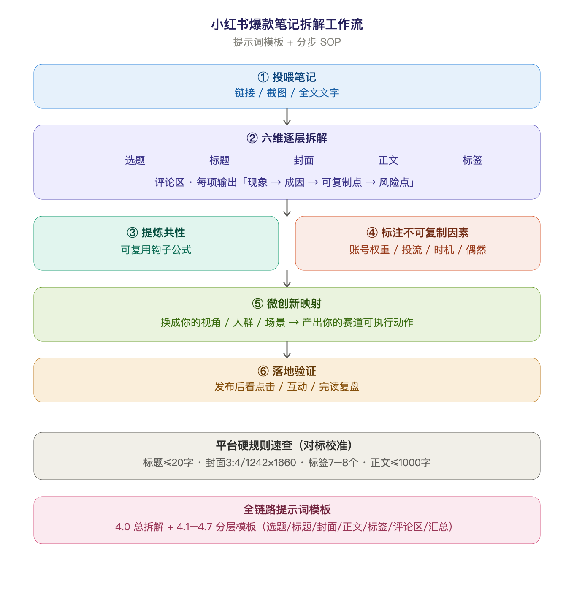

<p align="center">
  
</p>

<h1 align="center">小红书爆款笔记拆解工作流</h1>

<p align="center">
  
  
  
</p>

把一条小红书爆款笔记（链接 / 截图 / 全文文字），按「选题 → 标题 → 封面 → 正文 → 标签 → 评论区」六维度结构化拆解，提炼可复用的钩子公式、标注不可复制因素，并映射成你赛道的可执行动作。

一套可直接复制的**提示词模板 + 分步 SOP**，适用于情感文学、穿搭、成长等个人 IP 内容创作，也适用于任意赛道的内容对标与选题挖掘。

## 能做什么

- **六维逐层拆解**一条爆款笔记
- 提炼「可复用钩子公式」与「不可复制因素」
- 映射回你自己的赛道，给出可执行动作
- 内置**平台硬规则速查**（标题字数 / 封面尺寸 / 标签配比 / 正文结构 / 分发机制）

## 快速开始

直接投喂一条笔记，例如：

> 帮我拆这条笔记 [链接]，赛道是伤感随笔

如果没有指定赛道，会先问一句再开始。

## 安装

把整个 `xiaohongshu-note-decomposer` 文件夹复制到对应目录：

| 客户端 | 目标目录 |
|--------|----------|
| WorkBuddy | `~/.workbuddy/skills/` |
| CodeBuddy | `~/.codebuddy/skills/` |

复制后重启或刷新会话即可加载。

## 工作流概览

1. **投喂笔记** — 链接 / 截图 / 全文文字
2. **六维拆解** — 选题 → 标题 → 封面 → 正文 → 标签 → 评论区
3. **提炼共性** — 可复用钩子公式
4. **标注不可复制因素** — 账号权重 / 投流 / 时机 / 偶然
5. **微创新映射** — 换成你的视角 / 人群 / 场景
6. **落地验证** — 发布后看点击 / 互动 / 完读复盘

## 目录结构

```
xiaohongshu-note-decomposer/
├── SKILL.md        # skill 本体，含全部提示词模板与 SOP
├── README.md       # 本说明文档
├── LICENSE         # MIT 开源协议
└── assets/
    └── workflow.png  # 工作流流程图
```

## License

[MIT](LICENSE)
